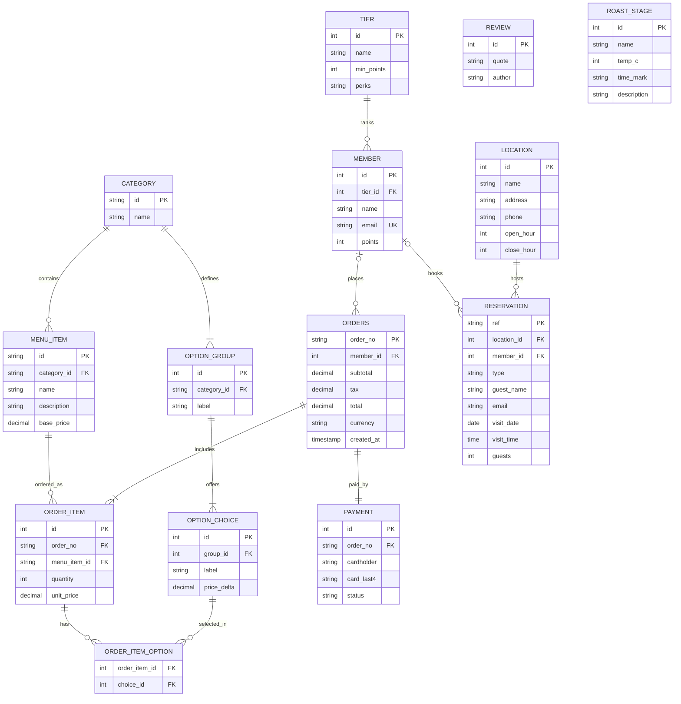

# ER-диаграмма VELVET & BEAN

Концептуальная модель данных сайта. На самом сайте базы данных нет: корзина и формы работают в браузере.
Диаграмма показывает, как эти данные хранились бы в реальной базе. GitHub рисует её автоматически.

## Пояснения

- **Меню и опции.** У категории есть позиции и группы опций (молоко, сладость, температура, размер, помол). Доплата за вариант хранится в `price_delta`.
- **Заказ.** Строки заказа `ORDER_ITEM` связаны с выбранными опциями через `ORDER_ITEM_OPTION` (связь «многие ко многим»). У заказа одна запись об оплате `PAYMENT`, в ней только последние 4 цифры карты.
- **Валюта.** Цены хранятся в долларах, поле `currency` в `ORDERS` фиксирует валюту, в которой гость увидел итог (KZT, RUB или USD).
- **Клуб.** Участник `MEMBER` относится к одному уровню `TIER`.
- **Бронирования.** Бронь привязана к кофейне `LOCATION`. Участник клуба необязателен, как и в заказе.
- **Справочники.** `REVIEW` и `ROAST_STAGE` ни с чем не связаны. Переводы текстов на казахский, русский и английский в диаграмму не вынесены, они лежат в коде сайта.
- Таблица называется `ORDERS`, потому что `ORDER` зарезервировано в SQL.
